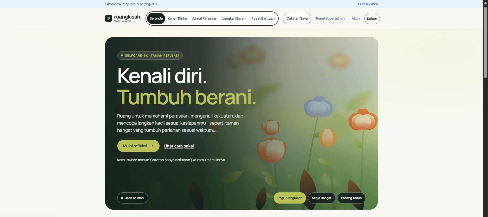
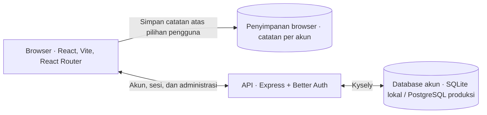

<div align="center">
  

  <h1>RuangKisah · Selfcare-BK</h1>

  <p><strong>Kenali diri. Tumbuh berani.</strong></p>
  <p>Ruang refleksi digital untuk siswa SMA lintas sekolah agar lebih mengenal diri, memahami perasaan, dan melatih keberanian melalui langkah kecil.</p>

  <p>
    
    
    
    
  </p>

  <p>
    <a href="https://ruangkisah.vercel.app/"><strong>Buka aplikasi</strong></a>
    · <a href="https://ruangkisah.vercel.app/api/health">Status API</a>
    · <a href="#menjalankan-secara-lokal">Instalasi lokal</a>
    · <a href="./DEPLOY_VERCEL.md">Panduan deployment</a>
  </p>
</div>



## Daftar Isi

- [Ringkasan Proyek](#ringkasan-proyek)
- [Fitur Unggulan](#fitur-unggulan)
- [Alur Penggunaan](#alur-penggunaan)
- [Arsitektur dan Stack](#arsitektur-dan-stack)
- [Struktur Repositori](#struktur-repositori)
- [Menjalankan Secara Lokal](#menjalankan-secara-lokal)
- [Variabel Lingkungan](#variabel-lingkungan)
- [Deployment](#deployment)
- [Privasi dan Data](#privasi-dan-data)
- [Pengujian](#pengujian)
- [Dokumentasi Proyek](#dokumentasi-proyek)

## Ringkasan Proyek

RuangKisah adalah media pendamping Bimbingan dan Konseling (BK) untuk refleksi mandiri. Siswa dapat memilih aktivitas sesuai kebutuhan, mengisi sesuai kesiapan, meninjau rangkuman jawabannya, lalu memutuskan apakah ingin menyimpan hasil di browser. Untuk pendampingan lebih lanjut, siswa dapat membuka Pusat Bantuan atau menemui Guru BK.

## Fitur Unggulan

| Fitur | Kegunaan |
| --- | --- |
| **Kenali Diriku** | Enam pertanyaan terpandu untuk mengenali pengalaman berhasil, kekuatan, minat, nilai pribadi, area pengembangan, dan tujuan kecil. |
| **Jurnal Perasaan** | Pilih emosi dan tulis apa yang terjadi, bagaimana kamu merespons, serta apa yang kamu butuhkan. |
| **Langkah Berani** | Buat target kecil, perbarui status, dan catat pengalaman setelah mencobanya. |
| **Catatan Saya** | Tinjau, filter, edit, atau hapus hasil refleksi, jurnal, dan target yang tersimpan di browser. |
| **Pusat Bantuan** | Baca pertanyaan umum dan lihat jalur pendampingan yang tersedia. Halaman ini dapat dibuka sebelum masuk. |
| **Taman Refleksi** | Pilih suasana Pagi RuangKisah, Senja Hangat, atau Padang Teduh, dengan kontrol untuk menjeda animasi. |
| **Mode Contoh** | Coba aktivitas dengan data fiktif setelah masuk. Sesi contoh memakai penyimpanan sementara. |
| **Pengelolaan Akun** | Admin meninjau pendaftaran dan mengelola akun siswa. Superadmin juga mengelola peran Admin dan melihat audit. Pengguna dapat mengganti kata sandi di halaman Akun atau meminta reset kepada pengelola. |

## Alur Penggunaan

1. Daftar sebagai **Siswa** dengan nama tampilan, email, dan kata sandi.
2. Tunggu hingga **Admin** atau **Superadmin** menyetujui akun melalui panel pengelola. Setelah disetujui, masuk dengan email dan kata sandi yang didaftarkan.
3. Pilih aktivitas sesuai kebutuhan. Isi pertanyaan yang ingin dijawab dan tinjau rangkumannya.
4. Pilih **Simpan di perangkat ini** atau akhiri tanpa menyimpan. Hasil yang disimpan dapat dibuka kembali melalui **Catatan Saya** pada browser yang sama.

## Arsitektur dan Stack



| Lapisan | Teknologi |
| --- | --- |
| Antarmuka | React 19, Vite, React Router, CSS Modules, Framer Motion |
| API dan autentikasi | Node.js 24, Express 5, Better Auth, Helmet |
| Data akun | Kysely, SQLite untuk pengembangan lokal, PostgreSQL di Supabase untuk produksi |
| Pengujian | Node.js Test Runner, Vitest, Testing Library, Playwright, GitHub Actions |
| Hosting | Vercel menyajikan build frontend dan API pada satu origin |

## Struktur Repositori

```text
RUANGKISAH/
├── frontend/
│   ├── public/             # Logo dan favicon
│   ├── src/                # Halaman, fitur, komponen, dan penyimpanan lokal
│   └── tests/              # Unit, integrasi, dan end-to-end
├── backend/
│   ├── src/                # API, autentikasi, dan akses database
│   ├── scripts/            # Bootstrap, migrasi, dan impor akun
│   └── tests/              # Pengujian API dan database
├── api/                    # Entry point fungsi Vercel
├── docs/                   # Dokumentasi, pratinjau, dan laporan pengujian
├── .github/workflows/      # Pemeriksaan otomatis
├── DEPLOY_VERCEL.md        # Panduan deployment Vercel dan PostgreSQL
└── vercel.json             # Konfigurasi build dan routing
```

## Menjalankan Secara Lokal

Gunakan **Node.js 24.x versi 24.15.0 atau lebih baru** dan **npm**. Dari root repositori, jalankan perintah berikut. Pada konfigurasi lokal bawaan, backend menyiapkan SQLite di `backend/.data/`.

```bash
npm --prefix frontend ci
npm --prefix backend ci
npm --prefix frontend run build
npm --prefix backend run start:local
```

Buka [http://localhost:4000](http://localhost:4000). Mode ini menyajikan build frontend dan API pada port yang sama. Untuk hot reload, jalankan `npm --prefix backend run dev` dan `npm --prefix frontend run dev` di dua terminal, lalu buka [http://localhost:5173](http://localhost:5173). Vite meneruskan permintaan `/api` ke port `4000`.

### Membuat Superadmin pertama

Buat akun pengelola melalui CLI satu kali. Gunakan email yang belum terdaftar dan kata sandi unik minimal 12 karakter. Contoh PowerShell berikut meminta kata sandi tanpa menampilkannya di terminal.

```powershell
$env:BOOTSTRAP_EMAIL = Read-Host 'Email Superadmin'
$env:BOOTSTRAP_PASSWORD = Read-Host 'Kata sandi Superadmin' -MaskInput
try {
    npm --prefix backend run bootstrap
} finally {
    Remove-Item Env:BOOTSTRAP_EMAIL, Env:BOOTSTRAP_PASSWORD
}
```

Masuk ke aplikasi dengan akun tersebut, buka **Panel Superadmin**, lalu gunakan menu **Persetujuan Akun** untuk menyetujui pendaftaran siswa.

## Variabel Lingkungan

Backend membaca `backend/.env` bila tersedia. Gunakan [template lokal](./backend/.env.example), [template produksi](./backend/.env.production.example), dan [template frontend](./frontend/.env.example).

| Variabel | Fungsi |
| --- | --- |
| `PUBLIC_URL` | Origin aplikasi, misalnya `http://localhost:5173` untuk pengembangan dan origin HTTPS situs untuk produksi. |
| `DATABASE_PROVIDER` | `sqlite` untuk pengembangan lokal atau `postgres` untuk produksi. |
| `DATABASE_URL` | URI PostgreSQL untuk aplikasi ketika memakai `postgres`. |
| `MIGRATION_DATABASE_URL` | URI administratif untuk menjalankan migrasi secara terpisah. |
| `DATABASE_CA_CERT` | Sertifikat CA tambahan bila diperlukan untuk koneksi PostgreSQL. |
| `AUTH_SECRET` | Secret sesi minimal 32 karakter. Lokal membuat secret otomatis bila kosong. Produksi memakai nilai yang stabil. |
| `BOOTSTRAP_EMAIL`, `BOOTSTRAP_PASSWORD`, `BOOTSTRAP_NAME` | Identitas Superadmin untuk bootstrap CLI. Nama dapat dikosongkan. |
| `VITE_HELP_*` | Informasi kontak pendamping yang opsional dan bersifat publik. |

Simpan kredensial database, secret sesi, dan kata sandi bootstrap di lingkungan backend yang sesuai. Variabel `VITE_*` dapat terbaca di browser.

## Deployment

Pada Vercel, gunakan **root repositori** sebagai Root Directory dan **Node.js 24.x**. Konfigurasi `vercel.json` membangun frontend ke `frontend/dist` dan meneruskan permintaan API ke `api/index.js`.

Untuk deployment baru, siapkan PostgreSQL, jalankan `npm --prefix backend run db:migrate` dengan koneksi administratif, lalu konfigurasi koneksi runtime dengan izin terbatas. Setelah deployment siap, periksa `/api/health` dan uji alur **daftar → persetujuan pengelola → masuk**. Pengelola menyetujui akun langsung dari panel tanpa tahap verifikasi email. [Panduan Vercel dan Supabase](./DEPLOY_VERCEL.md)

## Privasi dan Data

- **Catatan di browser.** Isi refleksi, jurnal, dan target tersimpan hanya pada browser, perangkat, dan origin situs yang digunakan saat pengguna memilih untuk menyimpan. Data dipisahkan per akun. Panel pengelola hanya memuat data akun dan aktivitas pengelola.
- **Akun di server.** Server menyimpan identitas dasar, status persetujuan, peran, sesi, dan audit pengelolaan. Kata sandi disimpan dalam bentuk hash dan sesi memakai cookie `HttpOnly`.
- **Kontrol pengguna.** Catatan dapat dihapus satu per satu melalui **Catatan Saya** atau sekaligus melalui **Privasi & Data**. Catatan lokal dapat dibaca oleh orang yang memiliki akses ke penyimpanan profil browser tersebut.
- **Catatan dari versi sebelumnya.** Jika tersedia, gunakan **Pindahkan catatan lama** di halaman **Privasi & Data** untuk memindahkan catatan milik sendiri ke akun yang masih kosong.

## Pengujian

Jalankan dari root repositori setelah memasang dependensi. Perintah E2E juga memerlukan browser Playwright.

```bash
npm --prefix backend run lint
npm --prefix backend run format:check
npm --prefix backend test
npm --prefix backend run test:postgres
npm --prefix frontend run lint
npm --prefix frontend run format:check
npm --prefix frontend run test:run
npm --prefix frontend run build
npm --prefix frontend exec -- playwright install chromium firefox webkit
npm --prefix frontend run test:e2e
```

Pengujian E2E memakai akun fiktif dan database terisolasi. Rangkaian pemeriksaan otomatis tersedia di [GitHub Actions](./.github/workflows/verify.yml).

## Dokumentasi Proyek

| Dokumen | Isi |
| --- | --- |
| [PRD](./PRD.md) | Tujuan produk, sasaran pengguna, dan kebutuhan fitur. |
| [Panduan desain](./design.md) dan [struktur teknis](./structure.md) | Arah visual, pola antarmuka, dan organisasi kode. |
| [Frontend](./frontend/README.md) dan [backend](./backend/README.md) | Catatan teknis tiap bagian aplikasi. |
| [Changelog](./docs/CHANGELOG.md) dan [audit UI](./UI_AUDIT.md) | Riwayat perubahan serta temuan antarmuka. |
| [Laporan pengujian](./docs/testing/) dan [rencana uji pengguna](./docs/evaluation/rencana-uji.md) | Hasil pengujian teknis dan rencana evaluasi bersama pengguna. |
